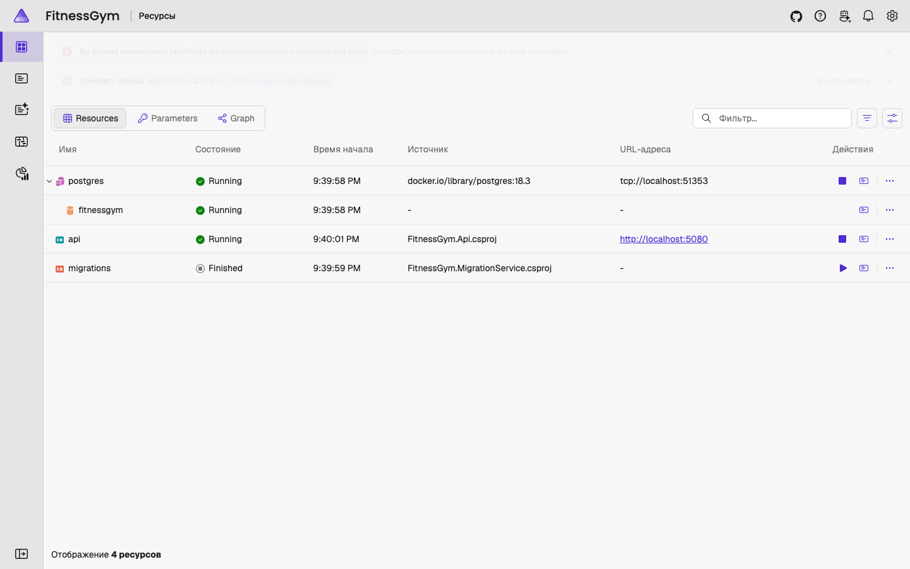
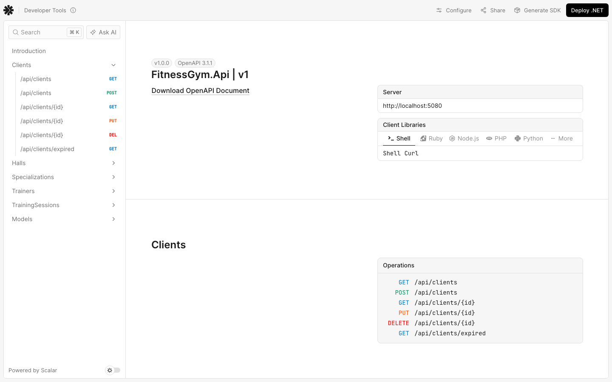

# FitnessGym — «Фитнес-клуб»

Лабораторные работы по курсу [«Разработка корпоративных приложений»](https://github.com/itsecd/enterprise-development).

**Вариант 55** — предметная область «Фитнес-клуб», СУБД PostgreSQL, брокер сообщений RabbitMQ.

## Предметная область

В базе данных фитнес-клуба содержится информация о записях клиентов на персональные занятия к тренерам.

- **Person** — базовый класс с персональными данными, общими для клиента и тренера: номер паспорта, ФИО, пол (`Gender` — перечисление), дата рождения.
- **Client** — клиент фитнес-клуба: телефон, дата начала и дата окончания абонемента.
- **Trainer** — тренер: специализация (сущность-справочник `Specialization`), стаж работы.
- **TrainingSession** — запись клиента на занятие: клиент, тренер, дата и время начала (окончание может проставляться позднее), название зала, признак пробного посещения.

## Структура решения

- `src/FitnessGym.Domain` — сущности предметной области, перечисления, интерфейсы репозиториев (паттерн Repository).
- `src/FitnessGym.Contracts` — DTO с валидационными атрибутами и интерфейсы сервисов.
- `src/FitnessGym.Application` — реализация сервисов: маппинг сущностей в DTO, бизнес-логика, аналитические запросы.
- `src/FitnessGym.Infrastructure.InMemory` — реализации репозиториев для unit-тестов предыдущих лабораторных.
- `src/FitnessGym.Infrastructure.PostgreSql` — EF Core, конфигурации таблиц, миграции и SQL-запросы.
- `src/FitnessGym.MigrationService` — однократное применение миграций перед запуском API.
- `src/FitnessGym.AppHost` — оркестрация PostgreSQL и приложений через Aspire 13.5.4.
- `src/FitnessGym.ServiceDefaults` — health checks и телеметрия Aspire.
- `src/FitnessGym.Api` — REST API сервер (ASP.NET Core, .NET 10).
- `tests/FitnessGym.Tests` — unit-тесты, проверки репозиториев и HTTP-тесты (xUnit v3).
- `tests/FitnessGym.Tests/Integration` — запуск настоящих PostgreSQL, миграций и API через `DistributedApplicationTestingBuilder`.
- `tests/FitnessGym.Tests/Seeds` — тестовый датасид и контейнер его данных; рабочая база заполняется миграциями.

Рабочий API использует PostgreSQL через интерфейсы репозиториев. Контекст EF Core
и репозитории создаются в области HTTP-запроса; чтение выполняется без отслеживания.
Фильтрация, сортировка и аналитика выполняются в базе данных.
Контроллеры, сервисы и репозитории используют асинхронные контракты.
За клиентов, тренеров, специализации, занятия и залы отвечают отдельные сервисы.
При записи обновляются скалярные поля и внешние ключи, без сохранения графа навигаций.
Удаление записей со ссылками запрещено ограничениями PostgreSQL.

## Лабораторная работа №1 «Классы»

Объектная модель предметной области и unit-тесты аналитических запросов:
данные хранятся в памяти, не менее 10 экземпляров каждого класса.

1. Тренеры, стаж работы которых не менее 5 лет.
2. Проверка доступности зала для записи в данный момент.
3. Клиенты с просроченным абонементом, упорядоченные по ФИО.
4. Занятия за текущий месяц в выбранном зале.
5. Топ-5 наиболее популярных тренеров.

## Лабораторная работа №2 «Сервер»

REST API сервер, реализующий базовые CRUD-операции над сущностями
и предоставляющий результаты аналитических запросов. Данные хранятся в памяти
в виде коллекций.

### Запуск

```bash
dotnet run --project src/FitnessGym.AppHost
```

В текущей лабораторной требуются запущенный Docker, .NET SDK 10 и настроенный
параметр `postgres-password` (см. «Запуск через Aspire»).
Aspire поднимает PostgreSQL и применяет миграции; подробности ниже.
Сервер доступен на `http://localhost:5080`, OpenAPI-спецификация —
`http://localhost:5080/openapi/v1.json`.
Интерактивная документация Scalar с отправкой запросов — `http://localhost:5080/scalar/v1`.

### CRUD-эндпоинты

| Сущность | Методы |
|---|---|
| Клиенты | `GET/POST /api/clients`, `GET/PUT/DELETE /api/clients/{id}` |
| Тренеры | `GET/POST /api/trainers`, `GET/PUT/DELETE /api/trainers/{id}` |
| Специализации | `GET/POST /api/specializations`, `GET/PUT/DELETE /api/specializations/{id}` |
| Занятия | `GET/POST /api/sessions`, `GET/PUT/DELETE /api/sessions/{id}` |
| Залы | `GET /api/halls` |

Для POST и PUT используются `UpsertClientDto`, `UpsertTrainerDto`,
`UpsertSpecializationDto`, `UpsertTrainingSessionDto` без поля `id`.
Идентификатор создаётся в репозитории; при обновлении он берётся из маршрута.
Название специализации тренера заполняется сервером только в ответе.

- POST возвращает `201 Created`, DTO и заголовок `Location`.
- PUT возвращает `200 OK` и обновлённый DTO.
- DELETE возвращает `204 No Content`.
- Несуществующая запись — `404 Not Found`; удаление связанной записи или дубликат
  паспорта/названия специализации при POST/PUT — `409 Conflict` в формате `ProblemDetails`.
- Ошибки валидации — `400 Bad Request` в формате `ValidationProblemDetails`.
- Непредвиденные ошибки — `500 Internal Server Error` без внутренних деталей;
  исключение записывается в журнал, ответ содержит `traceId`.

Обязательные даты, пол и внешние ключи должны быть явно указаны.
Дата окончания абонемента не может предшествовать началу, а время окончания
занятия должно быть позже начала (либо отсутствовать).
Идентификаторы допускают `0`, поскольку исходный набор данных нумеруется с нуля.

Ограничения длины строк одинаковы в DTO и PostgreSQL (`TextLimits`):

| Поле | Максимум символов |
|---|---:|
| Номер паспорта | 20 |
| ФИО | 200 |
| Телефон | 32 |
| Название специализации | 100 |
| Название зала | 100 |

Номера паспортов уникальны отдельно в таблицах клиентов и тренеров. Названия
специализаций также уникальны; сравниваются точные значения с учётом регистра.
Превышение длины в POST/PUT возвращает `400`, а база дополнительно защищена
типами `varchar` и уникальными индексами.

### Аналитические эндпоинты

| Запрос | Эндпоинт |
|---|---|
| Тренеры со стажем не менее 5 лет | `GET /api/trainers/experienced?minYears=5` |
| Доступность зала для записи | `GET /api/halls/{hallName}/availability?at=...` |
| Клиенты с просроченным абонементом | `GET /api/clients/expired` |
| Занятия за текущий месяц в зале | `GET /api/sessions/current-month?hallName=...` |
| Топ-5 популярных тренеров | `GET /api/trainers/popular?count=5` |

Зал занят с момента начала занятия включительно до окончания, не включая его.
Если `EndsAt` не указан, для проверки доступности используется длительность
`TrainingSession.DefaultDurationMinutes` — 60 минут. Явно заданное время окончания
имеет приоритет; значение `EndsAt` в базе при проверке не изменяется.

## Лабораторная работа №3 «ORM»

Хранение переведено на PostgreSQL 18.3 с EF Core 10 и Npgsql.
`InitialSchema` создаёт четыре таблицы, внешние ключи с `Restrict`, индексы
и ограничения для интервалов дат и стажа. `SeedInitialData` заполняет
10 специализаций, 12 клиентов, 12 тренеров и 26 занятий.
`AddTextLimitsAndUniqueIndexes` добавляет ограничения строк и уникальные индексы
в уже существующую базу, сохраняя подходящие под ограничения данные. Если в своей
базе ранее созданы дубликаты или слишком длинные значения, перед обновлением их
нужно исправить: миграция завершится ошибкой, а не удалит или обрежет данные.

Начальные данные — фиксированный снимок на **8 ноября 2026 года**.
Они вставляются миграцией один раз и не пересоздаются при перезапуске.
Аналитические запросы используют текущую дату: со временем результаты
«текущего месяца» и просроченных абонементов закономерно меняются.
Идентификаторы начальных записей сохранены с нуля, последовательности
новых записей начинаются со 100, поэтому вставки не конфликтуют с датасидом.

`Person` остаётся общим CLR-классом; клиенты и тренеры имеют отдельные таблицы
и независимые идентификаторы. Даты рождения и абонементов хранятся как `date`.
Время занятий — местное время клуба, `timestamp without time zone`:
передавайте, например, `2026-11-08T12:00:00`, без `Z` и смещения часового пояса.
Даты с часовым поясом в запросах занятий и доступности зала возвращают `400`.

### Запуск через Aspire

```bash
dotnet restore
dotnet user-secrets set "Parameters:postgres-password" "<your-local-password>" --project src/FitnessGym.AppHost
dotnet run --project src/FitnessGym.AppHost
```

Нужны .NET SDK 10 и Docker с поддержкой Linux-контейнеров. Отдельная установка
Aspire CLI не требуется: DCP и dashboard подключаются пакетами NuGet версии 13.5.4.
Ссылка входа в dashboard выводится в консоль (обычно `http://localhost:15200`).

Порядок запуска: готовность PostgreSQL → успешное завершение `migrations` → API.
Если миграция завершается ошибкой, API не запускается. В dashboard у ресурса
`migrations` после успеха будет состояние `Finished`, у API — `Running` и успешная
проверка `/health`. Данные PostgreSQL сохраняются в именованном Docker volume
`fitnessgym-postgres-data` между запусками. Пароль задаётся секретным параметром
`postgres-password` через user-secrets (команда выше). Альтернатива для bash/zsh:
`env 'Parameters__postgres-password=<password>' dotnet run --project src/FitnessGym.AppHost`.
Строка подключения передаётся приложениям через `WithReference`; рабочий пароль
в исходниках не хранится. Для существующего тома задайте пароль, с которым база
была создана: смена параметра не меняет пароль внутри PostgreSQL.

Ранее автоматически названный том не переименовывается и не удаляется. При переходе
на именованный том прежние данные при необходимости перенесите резервной копией.

### Скриншоты

Ресурсы Aspire после применения миграций:



Интерактивная документация и отправка запросов через Scalar:



### Запуск с собственной PostgreSQL

Строку подключения задайте переменной окружения (пример для bash/zsh):

```bash
export ConnectionStrings__fitnessgym='Host=localhost;Port=5432;Database=fitnessgym;Username=postgres;Password=<password>'
dotnet run --project src/FitnessGym.MigrationService
dotnet run --project src/FitnessGym.Api
```

API самостоятельно не меняет схему. Перед его запуском примените миграции сервисом
выше либо командой `dotnet ef database update`.

### Работа с миграциями

```bash
dotnet tool restore
dotnet ef migrations list --project src/FitnessGym.Infrastructure.PostgreSql
dotnet ef database update --project src/FitnessGym.Infrastructure.PostgreSql
dotnet ef migrations has-pending-model-changes --project src/FitnessGym.Infrastructure.PostgreSql
```

Для добавления миграции после изменения модели:

```bash
dotnet ef migrations add MigrationName --project src/FitnessGym.Infrastructure.PostgreSql
```

Для отката используйте `dotnet ef database update <MigrationName>` с тем же
проектом и строкой подключения. Откат `SeedInitialData` удаляет начальные записи;
связанные пользовательские записи необходимо предварительно обработать.
Откат до `0` удаляет таблицы и все данные.

## Запуск тестов

Для полного прогона нужны .NET SDK 10 и запущенный Docker:

```bash
dotnet test
```

`Aspire.Hosting.Testing` запускает настоящий AppHost со ссылкой на его проект.
Фикстура ожидает готовности PostgreSQL, завершения миграций и успешной проверки
здоровья API. HTTP-клиент и строка подключения получаются из Aspire. Тестовый пароль
задаётся фикстурой; user-secrets и ручной запуск PostgreSQL для тестов не нужны.

Используется отдельный контейнер без рабочего volume (`UseVolumes=false`) и
динамические порты. Aspire удаляет тестовые ресурсы после прогона. Проверки
репозиториев создают отдельные временные базы внутри этого контейнера и удаляют
только их. Ошибка запуска инфраструктуры приводит к падению тестов, а не пропуску.

Проверяются запуск всей цепочки PostgreSQL → миграции → API, CRUD через настоящий
HTTP, сохранение данных в базе, ограничения длины строк и уникальности, ответы
`400`/`409`, миграции и откат, сохранность данных при обновлении схемы,
внешние ключи, отсоединённые навигации, аналитика и границы интервалов.
Дополнительные HTTP-проверки через `WebApplicationFactory` подтверждают сохранение
данных после пересоздания API и работу обработчиков ошибок.

Только тесты без Docker можно запустить фильтром xUnit:

```bash
dotnet test -- --filter-not-trait "Category=Integration"
```

GitHub Actions запускает сборку и полный набор тестов через Aspire при push
в любую ветку и при pull request в `main`/`master`.
