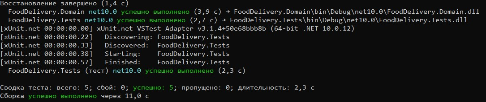

# Разработка корпоративных приложений — лабораторная работа №1

## «Классы»

В рамках первой лабораторной работы реализована объектно-ориентированная модель **службы доставки еды**, подготовлены тестовые данные и unit-тесты с использованием LINQ.

Данные хранятся **в памяти в виде коллекций**.

Вариант: 26

---

## Предметная область

Проект моделирует работу единой службы доставки еды из различных ресторанов.

### Основные сущности

| Класс | Назначение |
|---|---|
| `Client` | Клиент службы доставки |
| `Restaurant` | Ресторан-партнер |
| `Category` | Категория блюда (Справочник) |
| `Dish` | Блюдо из меню |
| `OrderItem` | Конкретная позиция (блюдо и количество) в чеке |
| `Order` | Оформленный заказ (Контракт) |


## Связи между сущностями

Основные связи предметной области:
- `Order` содержит информацию о `Client`, `Restaurant` и список позиций `OrderItem`
- `OrderItem` содержит информацию о `Dish` и количестве порций
- `Dish` содержит информацию о справочнике `Category`

---

## Fixture

Класс `FoodDeliveryFixture` содержит коллекции (таблицы данных в памяти):

```csharp
public List<Category> Categories { get; }
public List<Dish> Dishes { get; }
public List<Restaurant> Restaurants { get; }
public List<Client> Clients { get; }
public List<Order> Orders { get; }
```

В фикстуре вручную создаются жестко скоординированные данные:
- 10 категорий блюд;
- 15 наименований блюд;
- 10 ресторанов;
- 10 клиентов службы доставки;
- 20 оформленных заказов со вложенным составом позиций.

Итоговая сумма каждого заказа (`TotalAmount`) рассчитывается автоматически на основе цен входящих в него блюд и их количества, выступая строгим бизнес-контрактом.

---

## Unit-тесты

Тесты находятся в проекте `FoodDelivery.Tests`.

Для повторного использования одного набора данных используется `FoodDeliveryFixture`.

### `DomainTests`

Тесты проверяют корректность созданного датасета, контракты инициализации свойств `required` и реляционную целостность связей между заказами, ресторанами и клиентами.

### `QueriesTests`

В тестах реализованы пять сложных аналитических LINQ-запросов:
1. Вывод топ-5 ресторанов по общему количеству оформленных заказов (`GroupBy` + `Take`).
2. Поиск и вывод списка заказов с минимальным временем доставки (`Min`).
3. Сведения обо всех клиентах, заказывавших в выбранном ресторане, упорядоченные по алфавиту (`Distinct` + `OrderBy`).
4. Сводная информация по каждой категории блюд за указанный период: число уникальных заказов, средний чек и общая сумма (`SelectMany` + `GroupBy`).
5. Поиск клиента, который суммарно потратил на доставку наибольшую сумму за всё время работы приложения (`Sum` + `OrderByDescending`).

---

## Запуск тестов

```powershell
dotnet test
```

## Результаты


