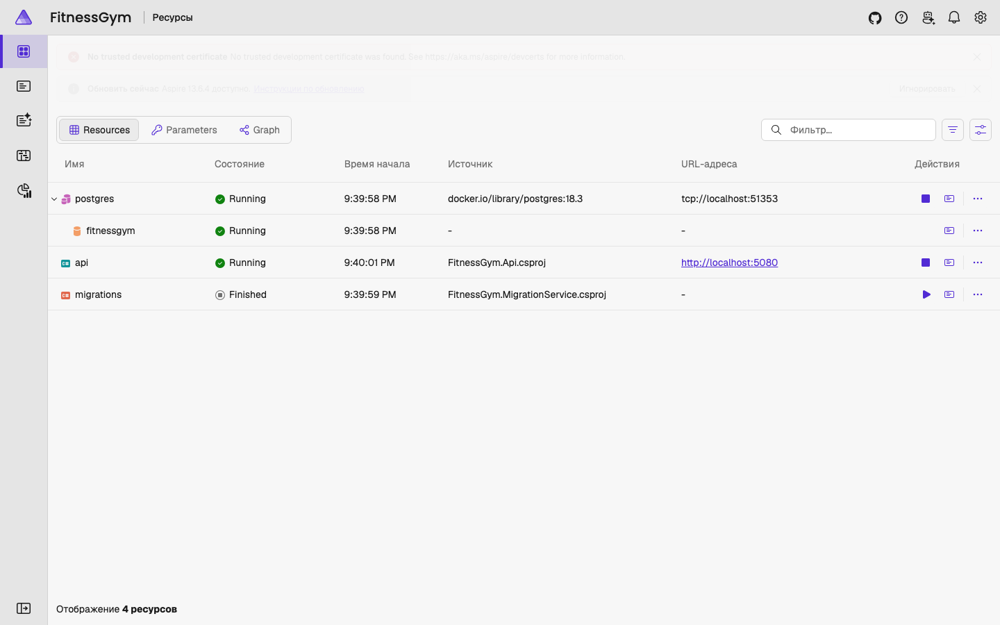
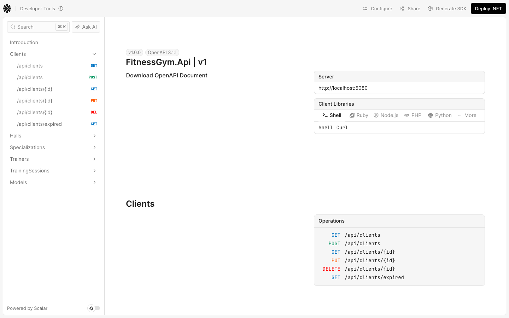

# FitnessGym — «Фитнес-клуб»

Лабораторные работы по курсу [«Разработка корпоративных приложений»](https://github.com/itsecd/enterprise-development).

**Вариант 55** — предметная область «Фитнес-клуб», СУБД PostgreSQL, брокер сообщений RabbitMQ.

## Предметная область

В базе данных фитнес-клуба содержится информация о записях клиентов на персональные занятия к тренерам.

- **Person** — базовый класс с персональными данными, общими для клиента и тренера: номер паспорта, ФИО, пол (`Gender` — перечисление), дата рождения.
- **Client** — клиент фитнес-клуба: телефон, дата начала и дата окончания абонемента.
- **Trainer** — тренер: специализация (сущность-справочник `Specialization`), стаж работы.
- **TrainingSession** — запись клиента на занятие: клиент, тренер, дата и время начала (окончание может проставляться позднее), название зала, признак пробного посещения.

## Структура решения

- `src/FitnessGym.Domain` — сущности предметной области, перечисления, интерфейсы репозиториев (паттерн Repository), генератор тестовых данных.
- `src/FitnessGym.Contracts` — DTO с валидационными атрибутами и интерфейсы сервисов.
- `src/FitnessGym.Application` — реализация сервисов: маппинг сущностей в DTO, бизнес-логика, аналитические запросы.
- `src/FitnessGym.Infrastructure.InMemory` — реализации репозиториев для unit-тестов предыдущих лабораторных.
- `src/FitnessGym.Infrastructure.PostgreSql` — EF Core, конфигурации таблиц, миграции и SQL-запросы.
- `src/FitnessGym.MigrationService` — однократное применение миграций перед запуском API.
- `src/FitnessGym.AppHost` — оркестрация PostgreSQL и приложений через Aspire 13.5.4.
- `src/FitnessGym.ServiceDefaults` — health checks и телеметрия Aspire.
- `src/FitnessGym.Api` — REST API сервер (ASP.NET Core, .NET 10).
- `tests/FitnessGym.Tests` — unit-тесты и HTTP-тесты API через `WebApplicationFactory` (xUnit v3).

Рабочий API использует PostgreSQL через интерфейсы репозиториев. Контекст EF Core
и репозитории создаются в области HTTP-запроса; чтение выполняется без отслеживания.
Фильтрация, сортировка и аналитика выполняются в базе данных.
Контроллеры, сервисы и репозитории используют асинхронные контракты.
За клиентов, тренеров, специализации, занятия и залы отвечают отдельные сервисы.
При записи обновляются скалярные поля и внешние ключи, без сохранения графа навигаций.
Удаление записей со ссылками запрещено ограничениями PostgreSQL.

## Лабораторная работа №1 «Классы»

Объектная модель предметной области и unit-тесты аналитических запросов:
данные хранятся в памяти, не менее 10 экземпляров каждого класса.

1. Тренеры, стаж работы которых не менее 5 лет.
2. Проверка доступности зала для записи в данный момент.
3. Клиенты с просроченным абонементом, упорядоченные по ФИО.
4. Занятия за текущий месяц в выбранном зале.
5. Топ-5 наиболее популярных тренеров.

## Лабораторная работа №2 «Сервер»

REST API сервер, реализующий базовые CRUD-операции над сущностями
и предоставляющий результаты аналитических запросов. Данные хранятся в памяти
в виде коллекций.

### Запуск

```bash
dotnet run --project src/FitnessGym.AppHost
```

В текущей лабораторной требуются запущенный Docker и .NET SDK 10.
Aspire поднимает PostgreSQL и применяет миграции; подробности ниже.
Сервер доступен на `http://localhost:5080`, OpenAPI-спецификация —
`http://localhost:5080/openapi/v1.json`.
Интерактивная документация Scalar с отправкой запросов — `http://localhost:5080/scalar/v1`.

### CRUD-эндпоинты

| Сущность | Методы |
|---|---|
| Клиенты | `GET/POST /api/clients`, `GET/PUT/DELETE /api/clients/{id}` |
| Тренеры | `GET/POST /api/trainers`, `GET/PUT/DELETE /api/trainers/{id}` |
| Специализации | `GET/POST /api/specializations`, `GET/PUT/DELETE /api/specializations/{id}` |
| Занятия | `GET/POST /api/sessions`, `GET/PUT/DELETE /api/sessions/{id}` |
| Залы | `GET /api/halls` |

Для POST и PUT используются `UpsertClientDto`, `UpsertTrainerDto`,
`UpsertSpecializationDto`, `UpsertTrainingSessionDto` без поля `id`.
Идентификатор создаётся в репозитории; при обновлении он берётся из маршрута.
Название специализации тренера заполняется сервером только в ответе.

- POST возвращает `201 Created`, DTO и заголовок `Location`.
- PUT возвращает `200 OK` и обновлённый DTO.
- DELETE возвращает `204 No Content`.
- Несуществующая запись — `404 Not Found`; удаление связанной записи — `409 Conflict`.
- Ошибки валидации — `400 Bad Request` в формате `ValidationProblemDetails`.
- Непредвиденные ошибки — `500 Internal Server Error` без внутренних деталей;
  исключение записывается в журнал, ответ содержит `traceId`.

Обязательные даты, пол и внешние ключи должны быть явно указаны.
Дата окончания абонемента не может предшествовать началу, а время окончания
занятия должно быть позже начала (либо отсутствовать).
Идентификаторы допускают `0`, поскольку исходный набор данных нумеруется с нуля.

### Аналитические эндпоинты

| Запрос | Эндпоинт |
|---|---|
| Тренеры со стажем не менее 5 лет | `GET /api/trainers/experienced?minYears=5` |
| Доступность зала для записи | `GET /api/halls/{hallName}/availability?at=...` |
| Клиенты с просроченным абонементом | `GET /api/clients/expired` |
| Занятия за текущий месяц в зале | `GET /api/sessions/current-month?hallName=...` |
| Топ-5 популярных тренеров | `GET /api/trainers/popular?count=5` |

## Лабораторная работа №3 «ORM»

Хранение переведено на PostgreSQL 18.3 с EF Core 10 и Npgsql.
`InitialSchema` создаёт четыре таблицы, внешние ключи с `Restrict`, индексы
и ограничения для интервалов дат и стажа. `SeedInitialData` заполняет
10 специализаций, 12 клиентов, 12 тренеров и 26 занятий.

Начальные данные — фиксированный снимок на **8 ноября 2026 года**.
Они вставляются миграцией один раз и не пересоздаются при перезапуске.
Аналитические запросы используют текущую дату: со временем результаты
«текущего месяца» и просроченных абонементов закономерно меняются.
Идентификаторы начальных записей сохранены с нуля, последовательности
новых записей начинаются со 100, поэтому вставки не конфликтуют с датасидом.

`Person` остаётся общим CLR-классом; клиенты и тренеры имеют отдельные таблицы
и независимые идентификаторы. Даты рождения и абонементов хранятся как `date`.
Время занятий — местное время клуба, `timestamp without time zone`:
передавайте, например, `2026-11-08T12:00:00`, без `Z` и смещения часового пояса.
Даты с часовым поясом в запросах занятий и доступности зала возвращают `400`.

### Запуск через Aspire

```bash
dotnet restore
dotnet run --project src/FitnessGym.AppHost
```

Нужны .NET SDK 10 и Docker с поддержкой Linux-контейнеров. Отдельная установка
Aspire CLI не требуется: DCP и dashboard подключаются пакетами NuGet версии 13.5.4.
Ссылка входа в dashboard выводится в консоль (обычно `http://localhost:15200`).

Порядок запуска: готовность PostgreSQL → успешное завершение `migrations` → API.
Если миграция завершается ошибкой, API не запускается. В dashboard у ресурса
`migrations` после успеха будет состояние `Finished`, у API — `Running` и успешная
проверка `/health`. Данные PostgreSQL сохраняются в Docker volume между запусками.
Пароль создаёт Aspire; строка подключения передаётся приложениям через
`WithReference`, в исходниках учётных данных рабочей базы нет.

### Скриншоты

Ресурсы Aspire после применения миграций:



Интерактивная документация и отправка запросов через Scalar:



### Запуск с собственной PostgreSQL

Строку подключения задайте переменной окружения (пример для bash/zsh):

```bash
export ConnectionStrings__fitnessgym='Host=localhost;Port=5432;Database=fitnessgym;Username=postgres;Password=<password>'
dotnet run --project src/FitnessGym.MigrationService
dotnet run --project src/FitnessGym.Api
```

API самостоятельно не меняет схему. Перед его запуском примените миграции сервисом
выше либо командой `dotnet ef database update`.

### Работа с миграциями

```bash
dotnet tool restore
dotnet ef migrations list --project src/FitnessGym.Infrastructure.PostgreSql
dotnet ef database update --project src/FitnessGym.Infrastructure.PostgreSql
dotnet ef migrations has-pending-model-changes --project src/FitnessGym.Infrastructure.PostgreSql
```

Для добавления миграции после изменения модели:

```bash
dotnet ef migrations add MigrationName --project src/FitnessGym.Infrastructure.PostgreSql
```

Для отката используйте `dotnet ef database update <MigrationName>` с тем же
проектом и строкой подключения. Откат `SeedInitialData` удаляет начальные записи;
связанные пользовательские записи необходимо предварительно обработать.
Откат до `0` удаляет таблицы и все данные.

## Запуск тестов

```bash
dotnet test
```

Без PostgreSQL выполняются unit- и HTTP-тесты на репозиториях в памяти;
интеграционные проверки явно помечаются как пропущенные.
Для полного прогона поднимите отдельную тестовую PostgreSQL:

```bash
docker run --rm -d --name fitnessgym-tests \
  -e POSTGRES_PASSWORD=fitnessgym-test \
  -p 127.0.0.1:15432:5432 postgres:18.3
docker exec fitnessgym-tests pg_isready -U postgres
export FITNESSGYM_TEST_CONNECTION_STRING='Host=localhost;Port=15432;Database=postgres;Username=postgres;Password=fitnessgym-test'
dotnet test
docker stop fitnessgym-tests
```

Запускайте тесты после успешного `pg_isready`. Тестовому пользователю нужно право
создания баз: каждая проверка создаёт временную базу с уникальным именем и удаляет
только её. Проверяются миграции и откат, повторный запуск, CRUD через HTTP,
сохранение данных после пересоздания API, ограничения внешних ключей,
отсоединённые навигации, аналитика и границы интервалов.

GitHub Actions запускает сборку и полный набор тестов с PostgreSQL при push
в любую ветку и при pull request в `main`/`master`.
