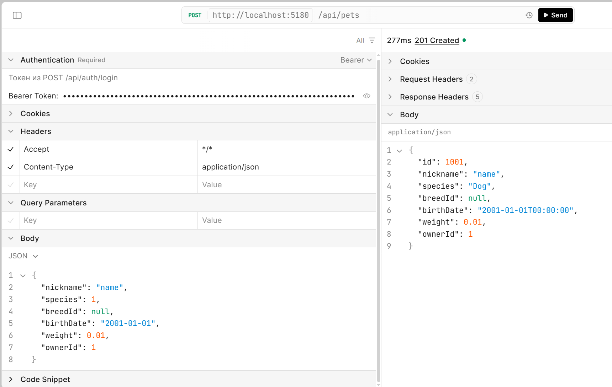
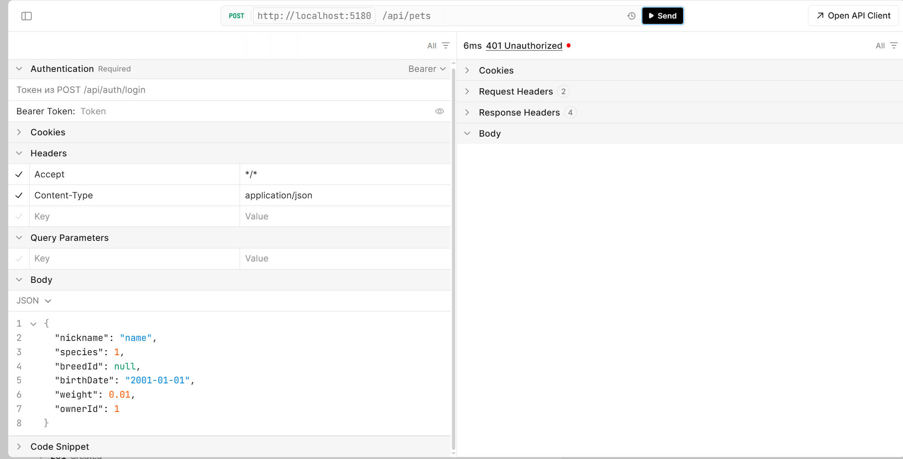
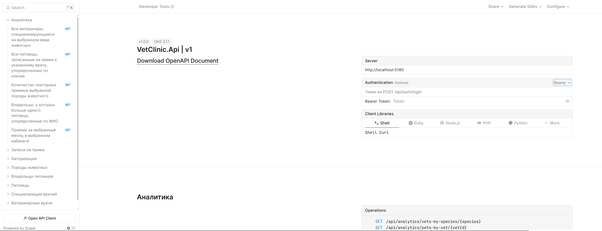
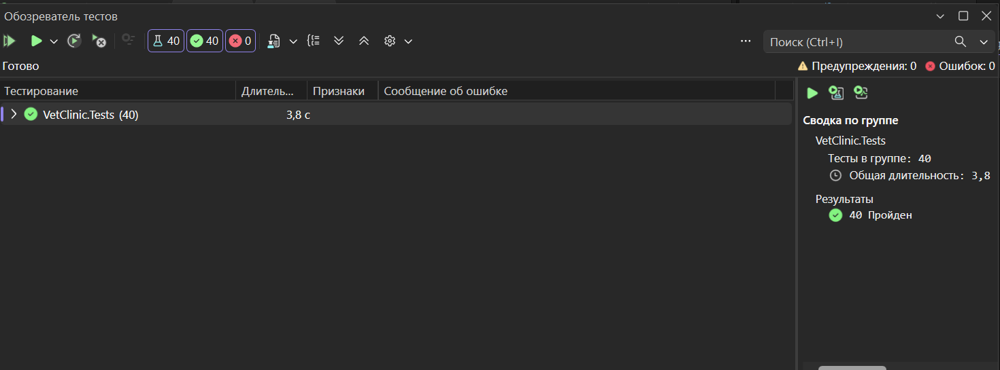

# Лабораторные 1–3 — Ветеринарная клиника

Ладыгин Денис Дмитриевич, группа 6411, вариант 10. База данных по варианту — MS SQL Server.

В лабе 1 реализована доменная модель ветклиники и unit тесты на LINQ-запросы из задания.
В лабе 2 добавлен REST API на ASP.NET Core: CRUD для всех сущностей и запросы из лабы 1.
В лабе 3 хранение переведено на MS SQL Server через EF Core, добавлены миграции и оркестратор Aspire; репозитории в памяти сохранены и используются в unit тестах.
Факультативно добавлена JWT-аутентификация.

## Структура

- `VetClinic.Shared` - перечисление видов животных, общее для Domain и Contracts
- `VetClinic.Domain` - доменные классы, интерфейсы репозиториев и начальные данные
- `VetClinic.Infrastructure.SqlServer` - контекст EF Core, конфигурации таблиц, миграции и репозитории
- `VetClinic.Infrastructure.InMemory` - те же интерфейсы репозиториев поверх коллекций в памяти, используются в unit тестах
- `VetClinic.Contracts` - DTO и интерфейсы сервисов
- `VetClinic.Application` - сервисы, маппинг и выдача JWT
- `VetClinic.ServiceDefaults` - телеметрия и проверки работоспособности Aspire
- `VetClinic.Api` - контроллеры, обработка ошибок, Scalar
- `VetClinic.AppHost` - оркестратор Aspire: SQL Server и API
- `VetClinic.Tests` - unit тесты (xunit v3) сервисов поверх репозиториев в памяти
- `VetClinic.IntegrationTests` - интеграционные тесты (xunit v3): Aspire поднимает SQL Server и API, проверяются запросы через HTTP

## Модель данных

- `Owner` - владелец: ФИО, адрес, телефон, список питомцев
- `Pet` - питомец: кличка, вид, порода, дата рождения, вес, владелец
- `Breed` - справочник пород с привязкой к виду животного
- `AnimalSpecies` - перечисление видов животных (Shared)
- `Vet` - врач: паспорт (уникальный), ФИО, год рождения, специализация, стаж
- `Specialization` - справочник специализаций, у общих специализаций вид не указан
- `Appointment` - запись на прием: дата и время, кабинет, питомец, врач, признак повторного приема
- `User` - пользователь API: имя для входа и хеш пароля

Связи выражены внешними ключами. Начальные данные лежат в `VetClinic.Domain/Seeds` и попадают в базу миграцией `SeedData`.
Таблицы и индексы создаёт миграция `InitialSchema`. Миграция `ExpandFullName` снимает ограничение длины с ФИО владельца и врача. API применяет миграции при старте.
Удаление каскадное на стороне базы: владелец -> питомцы -> записи на прием, врач -> записи на прием. При удалении породы или специализации у питомцев и врачей она сбрасывается.

## API

Для владельцев, питомцев, врачей, записей на прием, пород и специализаций есть: GET, GET {id}, POST, PUT {id} и DELETE {id} (`api/owners`, `api/pets`, `api/vets`, `api/appointments`, `api/breeds`, `api/specializations`).

Чтение открыто всем, POST, PUT и DELETE требуют токен.
Если запись не найдена - 404, если данные не прошли валидацию - 400, без токена - 401. Конфликт параллельной записи или нарушение ограничений целостности (например повтор номера паспорта) возвращает 409.
Кроме проверок DTO сервисы возвращают 400, если порода питомца относится к другому виду,
и 409, если у породы, к которой привязаны питомцы, пытаются сменить вид.
Для сохранения питомца и смены вида породы проверка и запись выполняются в одной сериализуемой транзакции.
DELETE возвращает 204, даже если записи уже нет.

## Авторизация

1. `POST api/auth/login` с телом `{"username": "admin", "password": "Vet2026!"}` возвращает JWT.
2. В Scalar вставить токен в поле авторизации Bearer, после этого доступны изменяющие запросы.

Пароль хранится в базе только в виде хеша, токен живет 60 минут.

| С токеном: 201 Created | Без токена: 401 Unauthorized |
|---|---|
|  |  |

## Запросы

1. Все ветеринары, специализирующиеся на выбранном виде животных - `api/analytics/vets-by-species/{species}`
2. Все питомцы, записанные на прием к указанному врачу, по кличке - `api/analytics/pets-by-vet/{vetId}`
3. Количество повторных приемов выбранной породы - `api/analytics/repeat-appointments-by-breed/{breedId}`
4. Владельцы, у которых больше одного питомца, по ФИО, с количеством питомцев - `api/analytics/owners-with-multiple-pets`
5. Приемы за месяц в выбранном кабинете - `api/analytics/appointments-by-room?roomNumber=&year=&month=`, год и месяц по умолчанию текущие, начальные приемы датированы 2024 годом: `api/analytics/appointments-by-room?roomNumber=205&year=2024&month=6` возвращает приемы 4 и 5

Фильтрация и сортировка выполняются в базе.

## Запуск

Нужен запущенный Docker Desktop: Aspire поднимает SQL Server в контейнере.

```sh
cd VetClinic
dotnet run --project VetClinic.AppHost
```

В дашборде Aspire у ресурса `api` есть ссылка на Scalar: https://localhost:7180/scalar/v1



Миграции:

```sh
dotnet tool restore
cd VetClinic
dotnet ef migrations add <Имя> -p VetClinic.Infrastructure.SqlServer -s VetClinic.Infrastructure.SqlServer -o Migrations
```

## Запуск тестов

```sh
cd VetClinic
dotnet test --solution VetClinic.slnx
```

Unit тесты сервисов работают через репозитории в памяти, Docker для них не нужен: создание и изменение сущностей, правила пород и видов, аналитика, вход по паролю.
Интеграционные тесты поднимают приложение через Aspire с настоящим SQL Server, поэтому нужен запущенный Docker Desktop: проверяются миграции, начальные данные,
ответы 400, 401 и 409 и каскадное удаление на стороне базы.


