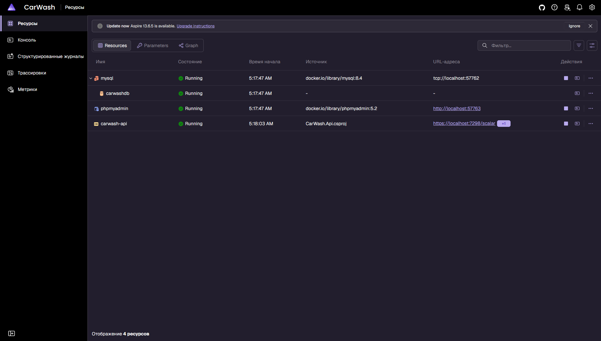
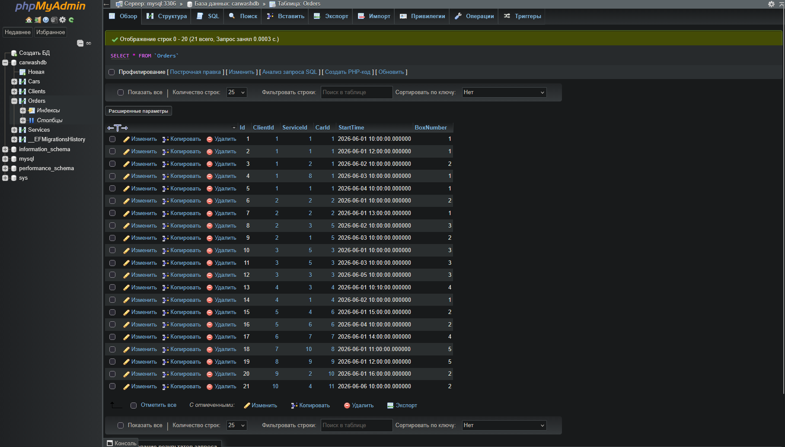
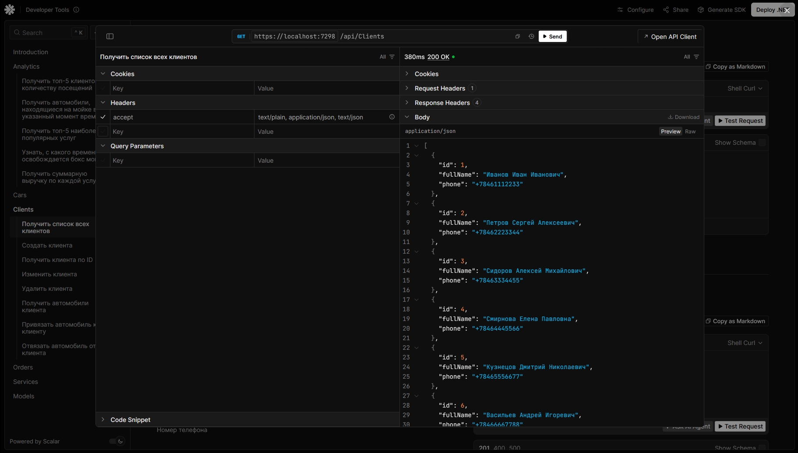
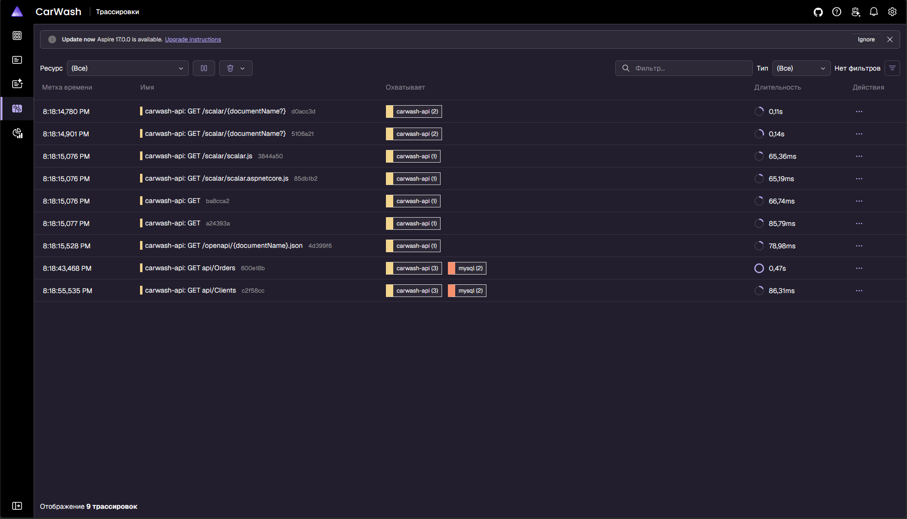

# Лабораторная работа №3

Учебный проект в рамках курса «Разработка корпоративных приложений». 

**Выполнил:** Фадеев Эльдар  
**Группа:** 6411  
**Вариант:** 23 (Автомойка | MySQL | NATS)

## Что реализовано в лабораторной работе №3

В третьей лабораторной работе хранение данных переведено с коллекций в памяти на базу данных **MySQL** с использованием **Entity Framework Core**. Созданы миграции для создания таблиц и их первоначального заполнения, а запуск сервера и базы данных настроен через оркестратор **.NET Aspire**.

### Структура проекта

Проект разделен на слои согласно принципам Clean Architecture:
* `CarWash.Shared` - общие типы, которыми пользуются несколько проектов. Содержит перечисление `CarCategory` (категория автомобиля).
* `CarWash.Domain` - ядро приложения. Содержит сущности (`Car`, `Client`, `Service`, `Order`), интерфейсы репозиториев и тестовые данные (`DataSeed`). Зависит только от `CarWash.Shared`.
* `CarWash.Contracts` - DTO (Data Transfer Objects) для запросов/ответов API, а также интерфейсы сервисов.
* `CarWash.Application` - бизнес-логика. Реализация сервисов (`CarService`, `ClientService`, `ServiceService`, `OrderService`, `AnalyticsService`) и преобразование доменных сущностей в DTO.
* `CarWash.Infrastructure.EfCore` - Хранение данных в MySQL через EF Core: контекст `CarWashDbContext`, конфигурации таблиц, репозитории, миграции с начальными данными. Соединение с БД берется из источника данных Aspire (`MySqlDataSource`).
* `CarWash.Infrastructure.InMemory` - репозитории, хранящие данные в памяти. Сервером больше не используются, остаются для юнит-тестов.
* `CarWash.Api` - слой представления. Контроллеры и конфигурация DI. Подключение к БД получает от оркестратора через пакет `Aspire.MySqlConnector` (health-check и телеметрия запросов к MySQL).
* `CarWash.ServiceDefaults` - Общие настройки Aspire для сервисов: OpenTelemetry (логи, метрики, трассировки), health-check эндпоинты `/health` и `/alive`. Подключается к серверу.
* `CarWash.AppHost` - Оркестратор .NET Aspire: запускает контейнер MySQL, создает базу данных, запускает сервер и передает ему строку подключения.
* `CarWash.Tests` - юнит-тесты бизнес-логики (xUnit v3).

### База данных

Используется MySQL 8.4 (в Docker-контейнере, запускаемом через Aspire). Провайдер EF Core - `Microting.EntityFrameworkCore.MySql` (поддерживаемый форк Pomelo с поддержкой EF Core 10).

Имена таблиц, столбцов, ключей и индексов в БД задаются в `snake_case` (пакет `EFCore.NamingConventions`).

Таблицы:
* `clients` - клиенты (`id`, `full_name`, `phone`).
* `cars` - автомобили (`id`, `license_plate`, `brand`, `client_id`). Внешний ключ `client_id` на владельца необязателен: автомобиль может существовать без владельца. При удалении клиента его автомобили остаются, а `client_id` становится `NULL`.
* `services` - услуги (`id`, `name`, `category`, `price`, `duration_minutes`). Категория хранится строкой (`Passenger`, `Suv`, `Truck`, `Minivan`).
* `orders` - заказы (`id`, `client_id`, `car_id`, `service_id`, `start_time`, `box_number`). Внешние ключи с `Restrict`: нельзя удалить клиента, автомобиль или услугу, пока на них ссылаются заказы.
* `__ef_migrations_history` - служебная таблица EF Core со списком примененных миграций.

Начальные данные (по 10 и более записей в каждой таблице) загружаются самой миграцией из `CarWash.Domain/Data/DataSeed.cs`. При старте сервер автоматически применяет непримененные миграции.

Создание новой миграции (из корня решения):
```bash
dotnet ef migrations add <ИмяМиграции> --project src/CarWash.Infrastructure.EfCore --startup-project src/CarWash.Api --output-dir Migrations
```

### Основные эндпоинты API:
* CRUD-операции для всех сущностей: `Cars` (Автомобили), `Clients` (Клиенты), `Services` (Услуги) и `Orders` (Заказы). В ответах по заказам клиент, автомобиль и услуга возвращаются вложенными объектами (`client`, `car`, `service`).
* Работа с автомобилями клиента:
	* `GET /api/clients/{id}/cars` - автомобили клиента.
	* `POST /api/clients/{id}/cars/{carId}` - привязать автомобиль к клиенту (409, если автомобиль уже принадлежит другому клиенту).
	* `DELETE /api/clients/{id}/cars/{carId}` - отвязать автомобиль от клиента.
* Аналитические эндпоинты:
	* `GET /api/analytics/top-clients` - Топ-5 клиентов по посещениям.
	* `GET /api/analytics/current-cars` - Автомобили на мойке в заданный момент времени.
	* `GET /api/analytics/top-services` - Топ-5 популярных услуг.
	* `GET /api/analytics/box-free-time` - Время освобождения выбранного бокса.
	* `GET /api/analytics/revenue` — Суммарная выручка по услугам.
* Документация: OpenAPI-спецификация генерируется средствами `Microsoft.AspNetCore.OpenApi`, для просмотра подключен интерфейс Scalar.

### Запуск

Требуется установленный и запущенный **Docker** (например, Docker Desktop): MySQL работает в контейнере.

Запуск всего приложения (MySQL, phpMyAdmin и сервер) из корня решения:
```bash
dotnet run --project src/CarWash.AppHost
```
Либо в Visual Studio: назначить запускаемым проектом `CarWash.AppHost` и нажать F5.

После запуска откроется дашборд Aspire (https://localhost:17261). В нем отображаются все ресурсы:
* `mysql` и `carwashdb` - сервер MySQL и база данных;
* `phpmyadmin` - веб-интерфейс для просмотра таблиц;
* `carwash-api` - сервер. Адрес указан в дашборде. Интерфейс Scalar доступен по адресу `<адрес сервера>/scalar`, проверка состояния - `<адрес сервера>/health`.

Трассировки запросов (в том числе обращений к MySQL) можно посмотреть на вкладке "Трассировки" дашборда.

Запускать `CarWash.Api` отдельно без оркестратора не нужно: строку подключения к БД ему передает AppHost.

### Тесты

```bash
dotnet test
```
Юнит-тесты работают на репозиториях в памяти и проверяют аналитические запросы (`AnalyticsService`). Автоматический запуск тестов при каждом push настроен через GitHub Actions.

### Скриншоты

Дашборд Aspire с запущенными ресурсами:



Таблицы базы данных в phpMyAdmin:



Сервер на данных из MySQL (Scalar):



Трассировки запросов в дашборде Aspire:


