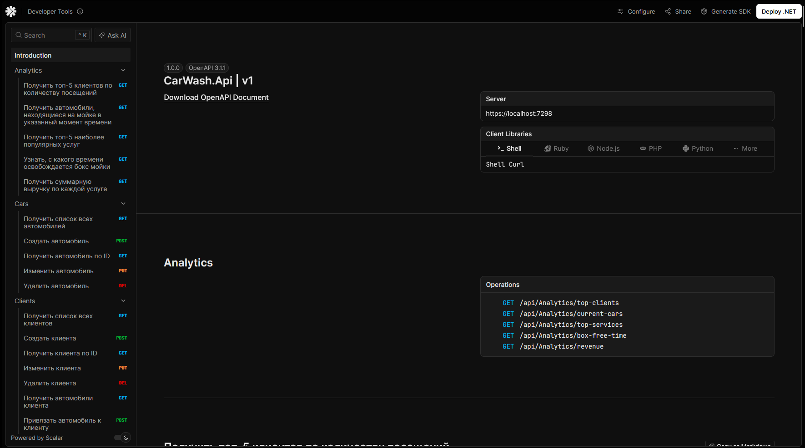
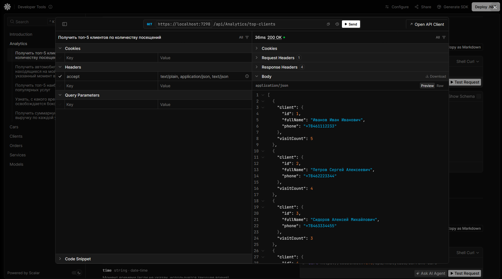

# Лабораторная работа №2

Учебный проект в рамках курса «Разработка корпоративных приложений». 

**Выполнил:** Фадеев Эльдар  
**Группа:** 6411  
**Вариант:** 23 (Автомойка | MySQL | NATS)

## Структура проекта (Лабораторная работа №2)

В рамках второй лабораторной работы реализовано серверное приложение на базе ASP.NET Core Web API (.NET 10)

### Основные сущности API:
* CRUD-операции для всех сущностей: `Cars` (Автомобили), `Clients` (Клиенты), `Services` (Услуги) и `Orders` (Заказы).
* Аналитические эндпоинты (перенесены из юнит-тестов):
	* `GET /api/analytics/top-clients` - Топ-5 клиентов по посещениям.
	* `GET /api/analytics/current-cars` - Автомобили на мойке в заданный момент времени.
	* `GET /api/analytics/top-services` - Топ-5 популярных услуг.
	* `GET /api/analytics/box-free-time` - Время освобождения выбранного бокса.
	* `GET /api/analytics/revenue` — Суммарная выручка по услугам.
* Хранение данных: На данном этапе данные хранятся в памяти (`InMemoryDataStore`).
* Документация: Реализован и настроен Swagger UI.

### Запуск сервера

Для запуска сервера выполните в корне решения:
```bash
dotnet run --project CarWash.Server
```
После запуска интерфейс Swagger доступен по адресу: http://localhost:5299/swagger

### Скриншоты




