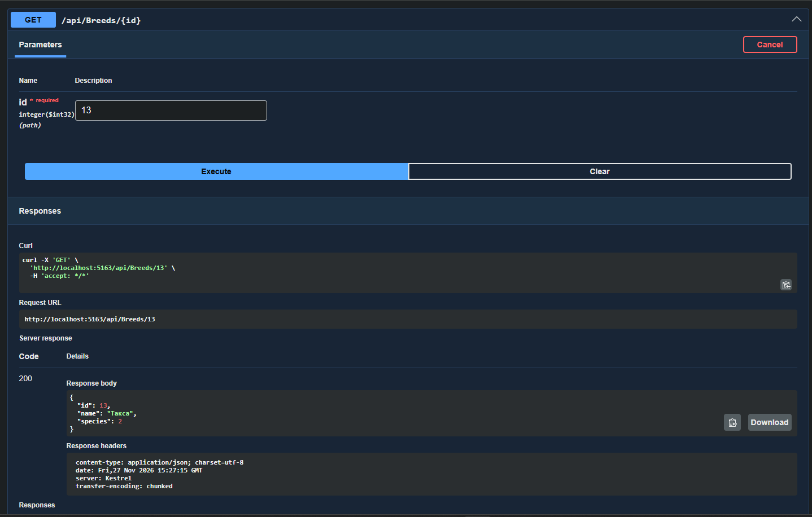
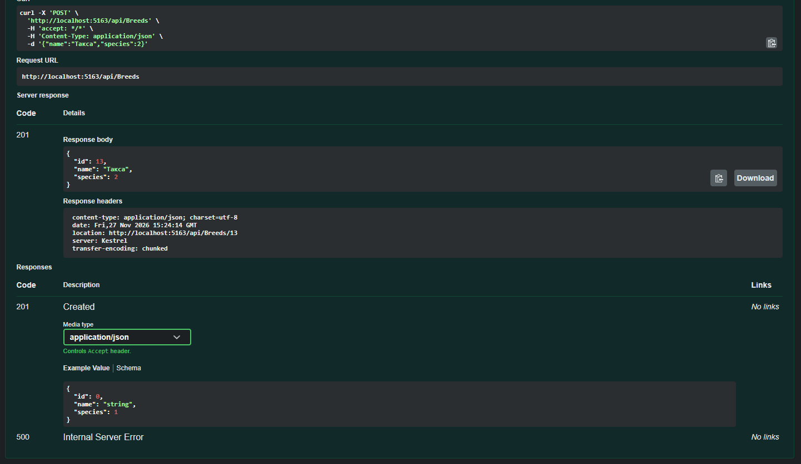

# Разработка корпоративных приложений

## Лабораторная работа №3 — ORM

Web API хранит данные в PostgreSQL через EF Core. Проект `VetClinic.Infrastructure.PostgreSql` содержит контекст, репозиторий и две миграции. `InitialCreate` создаёт шесть таблиц и внешние ключи, `SeedClinicData` загружает 62 демонстрационные записи из лабораторной №2. При запуске API применяет ожидающие миграции до обработки запросов.

Удаление записи, на которую ссылаются другие записи, возвращает HTTP 409.

### Запуск

Понадобятся .NET SDK 10 и запущенный Docker с поддержкой Linux-контейнеров. На Windows запустите [Docker Desktop](https://docs.docker.com/desktop/setup/install/windows-install/). Проверьте командой `docker info --format '{{.OSType}}'`, что Docker отвечает и выводит `linux`. Из корня репозитория выполните:

```powershell
dotnet dev-certs https --trust
dotnet run --project VetClinic/src/VetClinic.AppHost
```

В панели будут видны ресурсы `postgres`, `vetclinic` и `webapi`.
После запуска `webapi` откройте [Swagger](http://localhost:5163/swagger).

Если команда `docker` распознаётся, но не может подключиться к движку, запустите Docker Desktop и дождитесь его готовности. Затем перезапустите AppHost.

### Проверка

1. Выполните `GET /api/Breeds`. На чистой базе в ответе будет 12 пород.
2. Выполните `GET /api/Owners/multiple-pets`. В ответе будут Иванов и Петров, у каждого по два питомца.
3. Создайте породу через `POST /api/Breeds`, например с телом `{"name":"Такса","species":2}`. Запомните ID из ответа `201 Created`.
4. Остановите AppHost через Ctrl+C и запустите снова. `GET /api/Breeds/{id}` должен вернуть созданную породу. PostgreSQL хранит данные в Docker-томе между запусками.

### Результаты работы PostgraceSQL




---
