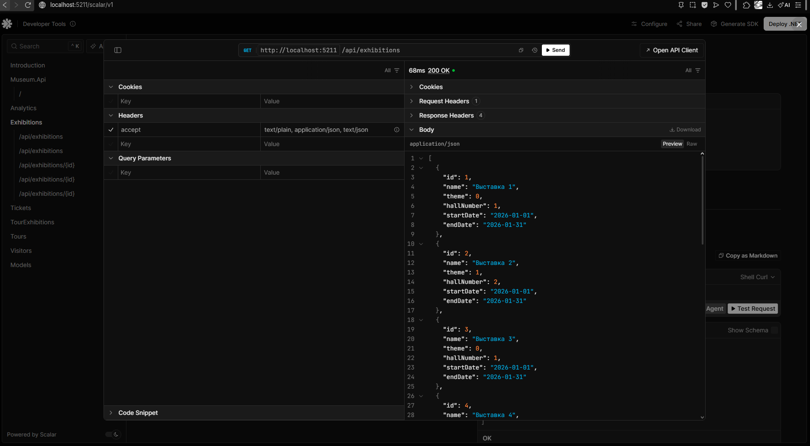
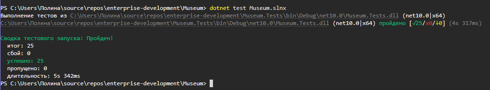

# Лабораторная работа №2 — «Сервер»

**ФИО:** Черникова Полина  
**Группа:** 6411  
**Лабораторная работа:** №2  
**Вариант:** 28  
**Предметная область:** Музей  
**База данных по варианту:** MS SQL Server  
**Шина сообщений по варианту:** RabbitMQ  

## Описание

Реализовано серверное приложение на ASP.NET Core Web API (.NET 10) для работы с данными музея.

Сервер поддерживает CRUD-операции для всех сущностей и предоставляет результаты пяти аналитических запросов согласно варианту задания.

На текущем этапе данные хранятся в памяти с использованием `MuseumContext` и заполняются через `DataSeeder`.

## Используемые технологии

- .NET 10
- ASP.NET Core Web API
- C#
- LINQ
- xUnit v3
- Scalar.AspNetCore
- GitHub Actions

## Структура проекта

- `Museum.Domain` — сущности, перечисления и данные музея.
- `Museum.Api` — REST API, контроллеры, DTO и аналитический сервис.
- `Museum.Tests` — модульные тесты с использованием xUnit v3.

Используемые сущности: `Exhibition`, `Tour`, `Visitor`, `Ticket`, `TourExhibition`.

## Реализованные возможности

### CRUD-операции

Для всех сущностей реализованы методы `GET`, `POST`, `PUT`, `DELETE`.

| Сущность | Адрес API |
|---|---|
| Выставки | `/api/exhibitions` |
| Экскурсии | `/api/tours` |
| Посетители | `/api/visitors` |
| Билеты | `/api/tickets` |
| Связи экскурсий и выставок | `/api/tour-exhibitions` |

Поддерживаются получение списка и отдельной записи, создание, изменение и удаление данных.

Также реализованы проверка входных данных и обработка ошибок HTTP.

### Аналитические запросы

1. Топ-5 выставок по количеству посетителей — `GET /api/analytics/top-exhibitions`.
2. Экскурсии с минимальным количеством участников — `GET /api/analytics/min-participant-tours`.
3. Статистика посещаемости по тематикам за период — `GET /api/analytics/attendance-by-theme`.
4. Экскурсии в выбранном зале за период — `GET /api/analytics/tours-in-hall`.
5. Посетители выбранной экскурсии с сортировкой по ФИО — `GET /api/analytics/tours/{tourId}/visitors`.

Для запросов за период используются параметры `startDate` и `endDate`, для выбранного зала — `hallNumber`.

## Запуск приложения

Из корня репозитория:

```powershell
dotnet run --project Museum.Api/Museum.Api.csproj
```

При стандартном локальном запуске сервер доступен по адресу:

`http://localhost:5211`

Пример запроса:

`http://localhost:5211/api/exhibitions`

### Документация API

Для просмотра и тестирования REST API используется Scalar.

После запуска приложения документация доступна по адресу:

`http://localhost:5211/scalar/v1`

Scalar позволяет просматривать доступные HTTP-методы, отправлять запросы и получать ответы сервера.

## Тестирование

Реализовано **25 unit-тестов**:

- 9 тестов предметной модели и LINQ-запросов;
- 5 тестов аналитического сервиса;
- 11 тестов контроллеров и обработки ошибок.

Все 25 тестов успешно пройдены.

Запуск тестов из корня репозитория:

```powershell
dotnet test Museum/Museum.slnx
```

Автоматическая сборка и запуск тестов настроены через GitHub Actions.

## Скриншоты

### Работа REST API через Scalar

Пример выполнения запроса на получение списка выставок:



### Результаты тестирования

Успешное выполнение 25 unit-тестов:



## Примечание

На текущем этапе данные хранятся в памяти. MS SQL Server и RabbitMQ указаны в соответствии с вариантом задания, но пока не подключены.
